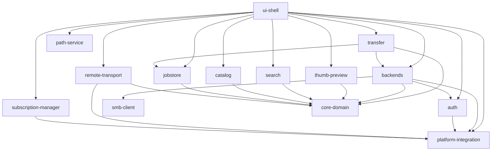

# アーキテクチャ

Iris は Cargo ワークスペースで、14 のクレートに分かれています。画面は [iced](https://iced.rs) の Elm 型アーキテクチャ（状態 → メッセージ → 更新 → 描画）で作り、ファイル操作やサムネイル生成などの重い処理は Tokio のタスクで UI スレッドの外で動かします。

## クレートの構成

| クレート | 役割 |
|---|---|
| `core-domain` | 全体で共有する型と取り決め。ストレージの共通インターフェース `BackendAdapter`、オブジェクト・一覧・メタデータの型、ファイル種別の判定（`media`）、ジョブのイベント、メモリ予算、SQLite の共通設定（`sqlite` フィーチャー） |
| `backends` | `BackendAdapter` の実装。ローカル（NFS マウントを含む）、SMB、S3、pCloud |
| `smb-client` | SMB2/3 の独自クライアント。OS のマウントを使わず、NTLMv2 認証・署名・暗号化・サーバー側コピーまで自前で扱う |
| `transfer` | コピー・移動の実行。方式の選択、チャンク転送、検証、再試行、ジョブ管理 |
| `jobstore` | 転送ジョブを SQLite に保存し、アプリ再起動後に再開できるようにする |
| `catalog` | 一覧とサムネイルのキャッシュ索引（SQLite）と、セッション限りの暗号化キャッシュ |
| `thumb-preview` | サムネイルとプレビューの生成、EXIF などのメタデータ抽出 |
| `search` | フィルタと再帰検索。ファイル一覧のセグメント、Bloom フィルタによる本文の候補絞り込み、あいまい一致 |
| `remote-transport` | マウント済みの SMB/NFS 共有と SSH ホストの対応表、SFTP / rsync による直接転送 |
| `subscription-manager` | フォルダの変更・ボリュームの抜き差し・クラウド接続の変化を監視して UI に知らせる |
| `path-service` | パスの正規化、表示用パス、URL の解析 |
| `auth` | トークンなどの資格情報を OS の資格情報ストアに保存する |
| `platform-integration` | OS ごとの機能。マウント一覧、ごみ箱、資格情報ストア、ファイル監視、更新日時の設定、既定アプリ |
| `ui-shell` | アプリ本体（実行ファイル `Iris`）。画面、状態、設定、i18n と、各クレートをつなぐ `AppRuntime` |

`vendor/block` は外部クレート `block` 0.1.6 の修正版です。描画に使う metal-rs が依存していますが、元の版は今後の Rust で拒否される型の書き方をしているため、API と ABI を保ったまま置き換えています（metal-rs がこのクレートを使わなくなれば不要になります）。

`vendor/cryoglyph` は外部クレート `cryoglyph` 0.1.0 の一時的な修正版です。iced_wgpu 経由で使われる lru 0.16 の `pop_lru` に解放後使用の問題があるため lru 0.18 に切り替えており、upstream が修正版をリリースすれば不要になります。

`vendor/paste` は RUSTSEC-2026-0543（paste はメンテナンス停止）への一時的な vendor パッチで、rav1e が必要とする `paste` の名前で保守中のフォーク pastey 0.1.1 を提供します。

## ui-shell の中身

| モジュール | 内容 |
|---|---|
| `state` | 画面の状態（ペイン、タブ、選択、ダイアログ、設定値）。描画と更新のどちらからも参照する唯一の状態 |
| `messages` | 画面から届くメッセージの定義 |
| `update` | メッセージごとの状態更新。時間のかかる処理は `Task` として返し、結果は再びメッセージで受け取る |
| `views` / `widgets` / `app` | 描画。`widgets` には仮想スクロールのリストなどの独自ウィジェットがある |
| `runtime` | `AppRuntime`。ストレージの登録と解決、ディレクトリ一覧、転送の実行、サムネイル生成、ジョブの保存などをまとめる。プロセスで 1 つだけ存在する |
| `config` | 設定ファイルの読み書き（`settings.json`・`layout.json`・`connections.json`） |
| `input` | キーボード、ドラッグ&ドロップ |
| `i18n` | Fluent による日本語・英語の文言（`i18n/{ja,en}/iris.ftl`） |

## 主な処理の流れ

### フォルダの表示

1. パスを決めると、まずキャッシュ索引に残っている一覧をすぐに表示します。
2. ローカルフォルダは名前と種類だけ（メタデータ段階 L0）を先頭から少しずつ読み、先頭の束（head）と残りの束（batch）に分けて画面に送ります。読んだ一覧はキャッシュ索引にも書き込みます。
3. 画面に見えている範囲の項目だけ、サイズや日時（L1）を後から取得します。
4. フォルダの変更は `subscription-manager` が監視し、変化があれば一覧を読み直します。

リモートのストレージ（SMB・S3・pCloud）は `BackendAdapter::list_names` でページ単位に読みます。画面上は `/__iris_remote__/<backend_id>/...` という仮想パスで表します。

### ローカルのネイティブ名と操作の安全性

一覧の `display_path` と名前は表示用の Unicode 文字列です。Unix の非 UTF-8 名や
Windows の不正な UTF-16 名は置換文字で表示しますが、実際にその置換文字を含む兄弟とは
別の識別子を持ちます。操作・ジョブ層はまだ文字列アドレスのため、元のパスが Unicode に
往復変換できない項目は `ObjectRef::local_path_is_lossy` を付け、読み取り・変更・転送を
明示的な Unsupported エラーで拒否します。通常の Unicode 名（日本語や実際の U+FFFD
を含む名前）は引き続き操作できます。

macOS の等価キーだけを NFC に正規化します。表示と I/O に使うパスは元の文字列を保ち、
Linux と Windows では正規化しません。正規化非依存はボリューム単位の性質であり、
macOS 上のクラウドやネットワーク越しのパスは必ずしも非依存ではありません。
サムネイルキャッシュはバックエンド ID と安定 ID もキーに含めるため、正規化後に
同一文字列になる異なるリモートオブジェクトが同じ画像を共有しません。
ディレクトリスナップショットの主キーもバックエンド ID と安定 ID を含むため、
表示パスの等価性だけで行が統合されることはありません。
検索インデックスの再同期は完全一致するスキャン済みレコードを優先し、正規化後の一致は
表記だけが変わった同一項目の再利用にだけ使うため、正規化非依存のボリュームに同居する
異なるファイルが統合されることはありません。

このマーカーは参照の複製とディレクトリキャッシュでも保持し、マーカーのない古い
キャッシュはスキーマ更新で再構築します。保留ジョブへの保存前にも検査し、再起動で
表示文字列を操作アドレスと誤認しないようにします。ローカルのディレクトリミラー検証は
`OsString` の名前をキーにして、異なるネイティブ名をまとめません。文字列キーを使う
バックエンド間の検証や再帰転送は、表現できないローカル名を検出した時点で拒否します。

### サムネイル

1. グリッド表示のとき、見えている範囲とその前後（先読み）の項目を候補にします。
2. `ThumbnailScheduler` が「表示中 → 近く → 背景」の優先度でキューに入れます。動画は見えているものだけ、RAW・新しい画像形式・PDF・動画は後回しにします。
3. `ThumbnailPipeline` が形式ごとに処理します。

| 形式 | 方法 |
|---|---|
| JPEG | EXIF の埋め込みサムネイルを使い、なければ DCT の縮小デコード |
| PNG・GIF・BMP・WebP・TIFF・ICO | `image` クレートで縮小 |
| AVIF・HEIF・JPEG 2000・JPEG XR・JPEG XL | 専用のデコーダ。対応できない変種は OS の機能（macOS は ImageIO、Windows は WIC） |
| RAW | コンテナ（TIFF・BigTIFF・CR3 の BMFF・RAF・X3F）を解析して埋め込みプレビューを取り出す。RAW データ自体はデコードしない |
| 動画 | FFmpeg で最初のキーフレーム |
| PDF | 1 ページ目（macOS は CoreGraphics、ほかは pdfium） |

リモートのファイルは必要な範囲だけを読みます（256 KiB 単位の窓を数個キャッシュ）。生成した画像はメモリ上のキャッシュに入り、メモリ予算を超えると古いものから捨てます。

### 既知のデコーダリスク

サムネイルとプレビューのデコーダについて、上流の脆弱性報告、Iris の呼び出し経路、対応を記録します。Iris では PoC を再現しておらず、安全性の保証でも、広範なセキュリティレビューでもありません。

FFmpeg（動画と一部の静止画のフォールバック）の範囲は `packaging/linux/ffmpeg.json` と各プラットフォームの `ffmpeg-README.md` に記録しています。以下はそれらとは異なり、ソースに静的リンクされるデコーダです。

#### JPEG 2000（OpenJPEG 2.5.3）

`crates/thumb-preview` は `jpeg2k` 0.10.1 を `openjpeg-sys` フィーチャーで使用します。`openjpeg-sys` 1.0.12 は crates.io の未改変のクレートを `Cargo.lock` のチェックサムで固定し、`cc` で同梱の C ソースをビルドして静的リンクします。`config/opj_config.h` が宣言する OpenJPEG のバージョンは 2.5.3 です。リポジトリ内のコピーや Cargo パッチは残していません。`modern_image::detect` が JP2/J2K のシグネチャを `decode_jpeg2000` に振り分けます。`decode_jpeg2000` は `jpeg2k::Image::from_bytes` を呼ぶ前に、Iris 側の純 Rust ガードで TLM/SOT の一貫性を検査します。

外部の報告では、この OpenJPEG リビジョンに 2 件のヒープ領域外書き込みがあります。Iris ではいずれの PoC も再現していません。

- CVE-2025-54874: JP2 ヘッダーの読み取り失敗時に `opj_jp2_read_header` で領域外書き込みが起こり得るという報告です。修正は OpenJPEG 2.5.4 に含まれます。Iris が使う `jpeg2k` は出力画像ポインターを null で初期化するため、報告の前提条件を満たしません。
- OSV-2025-219 / GHSA-78g4-xqwv-q3g8: TLM マーカーを伴う `opj_j2k_read_sod` の領域外書き込みです。上流の修正は `master` にあり、2.5.3 と 2.5.4 には含まれません。未修正の 2.5.3 では、タイルの tile-part 索引サイズが有効な TLM エントリ数から決まる一方、SOT の TPsot がその範囲外でも索引に書き込めます。

`j2k_tlm_sot_consistent` は JP2 の `jp2c` ペイロードまたは生の J2K バイト列から TLM と SOT だけを読み、Psot でタイルデータ部分を飛ばして、同じタイルの TLM エントリ数以上の TPsot をデコーダ呼び出し前に拒否します。Psot が 0 の最終 tile-part でも SOD までヘッダーを読み、終端 EOC を確認します。TLM のない入力は従来どおりデコーダに渡しますが、ST=3 や不正なエントリ列など TLM が不正な入力は比較を諦めずに拒否します。マーカー長が不正な場合や EOC なしで入力が終わる場合も拒否します。`scripts/test-openjpeg-unpatched.py` はリポジトリ内にコピーやパッチが残っていないことと、依存がチェックサム付きの crates.io 版であることを確認します。これは限定的な入力ガードの記録であり、安全性の保証やリリース判断ではありません。

#### PDFium（chromium/8138）

PDF のサムネイル生成では、macOS は CoreGraphics、Linux などは動的に読み込んだ PDFium を使います。Iris は PDFium をブラウザーのサンドボックスなしでプロセス内から FFI で呼び出すため、缺陷が存在する場合に影響を受けるのは Iris プロセス自体です。

外部の報告では CVE-2026-130976 として、PDFium の `cpdf_nametree.cpp` の `GetNodeLimits` と `PopulateAnnotationLinks` に関わる use-after-free が示されています。上流の勧告は 2026-11-17 に公表され、修正版は 158.0.8127.36 とされています。Iris が固定している bblanchon/pdfium-binaries の `chromium/8138` は 2026-11-04 のビルドで、その後の `chromium/8152`（2026-11-10）の変更一覧にはこの修正は現れません。変更一覧に修正が現れないことは、いずれのビルドにも修正が含まれないことの証拠にはなりません。ここで確認できるのは 2 つの日付付きビルドと変更一覧の観察だけで、各バイナリへの修正の含有は不明です。158 系統に対する修正が 159 系統の `chromium/8138` に含まれるとは限らないため、バージョン番号の大小は安全性の根拠になりません。

Iris では PoC を再現しておらず、脆弱性の適用性もリリース準備の判断もしていません。これは外部証拠に基づく限定的な残リスクの記録であり、PDFium のピンは変更していません。今後の更新は、修正を含むことが変更履歴で確認できるタグ、または下記の日付に基づく候補を、既存のサイズ・SHA-256・attestation のゲートと正確なリビジョンの CI スモークテストで検証したうえで行います。

上流の一次情報では、160.0.8165.0（`chromium/8165`、ソースコミット `83c18af693945b735503665259b728ba7d409fd0`）が 2026-11-16 17:35 UTC に公開された不変の release です。これは修正の出荷（2026-11-12）より後にビルドされているため日付に基づく低減候補ですが、変更一覧に修正コミットは現れません。GitHub API が報告するゲート対象アセットは `pdfium-linux-x64.tgz` 3,951,977 bytes / `ba7865e16c0271daab75256790be06c26272190afe6e2a70eae0bb39bb99089c`、`pdfium-linux-arm64.tgz` 3,817,479 bytes / `338f5dcc907a20331812ae8ab01b16ff18966f4a247d790c8ad8fb49029d768b`、`pdfium-win-x64.tgz` 4,043,420 bytes / `ca7338ae7779b8b1b82f4580305c4d762d214f8df1d54b47647fe3cc75989ded`、`pdfium-attestation.json` 18,361 bytes / `a198e725074f3321c0f21a94218cafc910740e0e0c8395530198855f7a918770` です。これらは API の報告値であり、アーカイブのローカル再計算と `gh attestation verify` による検証は未実施です。ピンは変更しておらず、正確なリビジョンの CI で PDF プレビューのスモークテストが通るまで差し替えません。

### コピーと移動

1. 貼り付けやドラッグ&ドロップでファイルの一覧（保留中の操作）を作り、ジョブとして `jobstore` に保存します。
2. 同名のファイルがあれば確認ダイアログを出します（上書き・スキップ・名前を変える、以降も同じ選択）。
3. ファイルごとに転送方式を選びます。

| 状況 | コピー | 移動 |
|---|---|---|
| 同じファイルシステム | クローン（APFS・Btrfs・XFS の reflink）。だめなら通常のコピー | 名前の変更 |
| 同じストレージのサーバー上 | サーバー側コピー（S3 CopyObject、SMB のサーバー側コピー） | サーバー側コピー → 検証 → 元を削除 |
| それ以外 | クライアントが読んで書く（大きいファイルは範囲を分けて並列） | クライアント経由のコピー → 検証 → 元を削除 |

4. マウント済みの共有に SSH の対応表があれば、SFTP または rsync で直接転送します。
5. 移動では、コピー後に検証（サイズ・日時・ETag、必要ならハッシュ）が通ってから元を削除します。
6. 進行状況はファイル単位でジョブに記録します。アプリが途中で終了しても、次回起動時に未完了のジョブを再開できます。範囲分割の転送は、終わったチャンクを飛ばして続きから再開します。

S3 の上書き以外の書き込みは、候補名を選ぶ HEAD だけに頼らず、最終要求にも `If-None-Match: *` を付けます。`Rename` は、バッファー済み PUT・`Vec` からの multipart・サーバー側コピーで 412 を受けたとき、最大 3 回まで空き名を選び直して条件付きで再試行します。PUT の 409 も最大 3 回再試行します。multipart 完了の 409 は新しい upload と全パーツの再送が必要なため、`Vec` を保持する書き込みでは再開し、消費済みストリームやセッションだけの完了 API ではその場で再生せず明示的に失敗します。サーバー側コピーの 409 も自動再試行しません。どの再試行でも条件ヘッダーを外さず、`Overwrite` だけは従来どおり無条件です。カスタム S3 エンドポイントの非上書き操作は、条件付き書き込みを使えると利用者が確認するまで無効です。

pCloud の制御 API は要求ごとに 30 秒で期限切れになり、接続確立は 10 秒で打ち切ります。ファイルのアップロード／ダウンロードには総所要時間の上限を設けず、ダウンロードの受信とアップロードの送信元読み出しが進むたびにアイドル期限を更新します。アイドル期限は `connections.json` の pCloud アカウントごとの `transfer_idle_timeout_secs`（正の秒数、既定値 30）です。停止した転送またはアップロード応答待ちはタイムアウトし、転送キャンセルは進行中の要求も中断します。旧形式でこの項目がない接続設定には既定値を使います。

同時に動かす転送の数は、ストレージの種類ごとの実績（転送速度）に応じて調整します。

### SMB クライアント

`SmbConnectionActor` が 1 本の TCP 接続を持ち、複数の要求を並行して送ります（メッセージ ID で応答を振り分け、クレジットを管理します）。まとめ送り（compound）で「開く → 読む／設定する → 閉じる」を 1 往復にし、署名（HMAC-SHA256・AES-CMAC）と暗号化（AES-CCM・AES-GCM）、SMB 3.1.1 の事前認証ハッシュにも対応しています。

要求の期限はキューへの受付待ちから始まり、キュー内・クレジット待ち・送信・応答待ちを含みます。`SmbActorConfig::default()` は期限 30 秒、未送信キュー 256 件です。`SmbConnectionActor::spawn_with_config` またはバックエンドの `SmbConnectionConfig.actor` で変更できます。キュー容量はクレジット待ちの先頭を含む未送信要求の総数で、送信済み要求やバイト数の上限ではありません。期限切れ・呼び出し元がキャンセルした未送信要求は除去し、生きている要求同士の FIFO 順を保ちます。

ディレクトリ一覧のポリシーは UI 設定ではなく `SmbConnectionConfig.listing` (`SmbListingConfig`) にあります。既定値はページ 100 件、保持カーソル最大 64 個、アイドル期限 30 秒です。ページ件数と最大数は非ゼロ、アイドル期限 0 は即時失効を意味します。各カーソルは同じ接続世代と OPEN 済みディレクトリを保持し、QUERY_DIRECTORY をページ要求に応じて送り、応答の余りを次ページへ残します。数値オフセットや `file_index` による再開ではありません。カーソルはアダプター専用の一回限りの不透明トークンで、別ディレクトリ・別世代・再利用・期限切れを拒否します。期限切れは次の一覧要求で回収し、上限時は最も古いものを回収します。回収・EOF・エラー時は CLOSE を試みます。最後のページが指定件数ちょうどなら、EOF 確認のため次のページが空になる場合があります。アダプター破棄、OPEN／ページ取得／CLOSE のキャンセル、または CLOSE 失敗時は同期的に世代を停止し、失われたハンドルや曖昧な継続を再利用しません。継続ページを新しい世代で再接続・再開することはありません。stat は親の列挙をせず、子の正確なパスを read-attributes アクセスで OPEN（ファイル／ディレクトリ制約なし）して CLOSE し、その応答メタデータを返します。

送信済み要求の期限切れ、送信の失敗・期限切れでは、応答とクレジットの所有関係が不確かな接続を再利用せず停止します。送信後に呼び出し元がキャンセルしても、応答の検証は期限まで続けます。`SmbPool` の無効化・置換は世代の actor を停止するため、古い actor のクローンが残っていても TCP 接続を保持しません。新しい世代への遅れた旧世代の無効化は影響せず、再接続は認証・署名・暗号化の交渉をやり直します。

### 検索とフィルタ

フォルダ内のフィルタは、表示中の一覧に名前（あいまい一致）・種類・サイズ・日付・カメラ・レンズ・GPS の条件をかけます。サブフォルダの再帰検索では、ファイルを走査して `SegmentRecord` の一覧（セグメント）を作り、結果を少しずつ画面に送ります。PDF の本文検索は、本文から作った Bloom フィルタで候補を絞ってから一致を確かめます。

## 保存するデータ

| データ | 形式 | 古い版のとき |
|---|---|---|
| 設定 | JSON（`schema_version` 付き） | 退避して初期値で起動し、通知する |
| キャッシュ索引 | SQLite（`user_version`） | 全テーブルを作り直す |
| 転送ジョブ | SQLite（`user_version`） | 全テーブルを作り直す |
| パスワード・トークン | OS の資格情報ストア | — |

古い形式を読み込むための互換処理は持ちません。形式を変えるときは版を上げ、古いデータは作り直します。

## Owned range-write staging

Local range copies never write to the public destination before installation. For a
journaled transfer, the job store records a session before creating its private
sibling staging directory. The session binds the job and entry, source backend,
object and version (ETag or modification-time/size), destination backend and object,
and range layout. Sources without a version identity and non-journaled copies use
fresh attempt-local staging without range reuse. Native staging paths are journaled
as lossless opaque locators, not Unicode display paths.

An OS file lock excludes concurrent session owners, including across processes.
Restart opens existing staging only and checks its manifest, file identity, length,
and binding. A completed range is reused only when its row names this session and
its checksum matches bytes read from this owned file. Before any range write or
installation, the stage's stable OS identity (Unix device/inode or Windows file
identity) is durably CAS-bound to the exact journal session. A nullable additive
field lets older sessions establish this proof only through normal stage validation.
Legacy or stale range rows are not reused. Missing or incomplete owned staging
without installation proof is discarded with its chunk rows and restarted fresh.
Cleanup requires the exact intent binding and an exclusive lock; replaced data,
mismatched bindings and live owners fail closed. Creation durably records immutable
intent before data and its file identity, so interrupted creation is recoverable.
Parallel source range reads and per-range retries remain active for missing ranges.
Before installation, the journal must contain the exact complete range set for the
session, with completed checksums. The store validates it, then advances a per-session
barrier generation in a SQLite transaction with `synchronous=FULL`; this actual row
change forces a WAL commit that syncs earlier checksum writes made under `NORMAL`.
Ordinary job writes retain `NORMAL`, and a failed durability barrier prevents
installation.

Cancellation of the transfer control or a dropped transfer future retains the
session for restart; outstanding filesystem work retains its lock until finished.
Transport/authentication errors, storage exhaustion and internal errors also retain
it. Successful atomic no-replace installation and definitive conflict, unsupported,
missing-source or permission failures remove staging and session/chunk rows.
Explicit session abandonment and job deletion also remove owned staging before
removing its journal; a live owner or identity mismatch refuses cleanup and keeps
the journal for diagnosis. Marking a job completed or canceled cleans remaining sessions.
Saving a finished job deletes it; a cancellation token alone does not delete a job.
If installation was interrupted after moving staging, missing stage data or metadata
permits read-only recovery only when the final path opens as the journal's exact
recorded OS file identity. Path, length, timestamps and matching bytes alone never
prove ownership. The source/session binding and every completed chunk checksum must
still verify; incomplete journals fail closed without writes. Completion rechecks
the final identity and does not install again. Jobstore cleanup owns stage removal
and retains the durable proof until session/chunk cleanup commits, including across
interrupted filesystem cleanup. No recovery path overwrites or deletes the public
destination; move still verifies the recovered copy before deleting its source.
