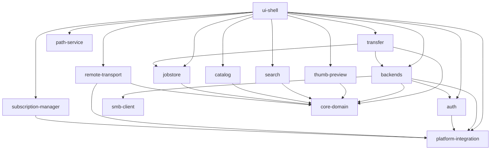

# アーキテクチャ

Iris は Cargo ワークスペースで、14 のクレートに分かれています。画面は [iced](https://iced.rs) の Elm 型アーキテクチャ（状態 → メッセージ → 更新 → 描画）で作り、ファイル操作やサムネイル生成などの重い処理は Tokio のタスクで UI スレッドの外で動かします。

## クレートの構成

| クレート | 役割 |
|---|---|
| `core-domain` | 全体で共有する型と取り決め。ストレージの共通インターフェース `BackendAdapter`、オブジェクト・一覧・メタデータの型、ファイル種別の判定（`media`）、ジョブのイベント、メモリ予算、SQLite の共通設定（`sqlite` フィーチャー） |
| `backends` | `BackendAdapter` の実装。ローカル（NFS マウントを含む）、SMB、S3、pCloud |
| `smb-client` | SMB2/3 の独自クライアント。OS のマウントを使わず、NTLMv2 認証・署名・暗号化・サーバー側コピーまで自前で扱う |
| `transfer` | コピー・移動の実行。方式の選択、チャンク転送、検証、再試行、ジョブ管理 |
| `jobstore` | 転送ジョブを SQLite に保存し、アプリ再起動後に再開できるようにする |
| `catalog` | 一覧とサムネイルのキャッシュ索引（SQLite）と、セッション限りの暗号化キャッシュ |
| `thumb-preview` | サムネイルとプレビューの生成、EXIF などのメタデータ抽出 |
| `search` | フィルタと再帰検索。ファイル一覧のセグメント、Bloom フィルタによる本文の候補絞り込み、あいまい一致 |
| `remote-transport` | マウント済みの SMB/NFS 共有と SSH ホストの対応表、SFTP / rsync による直接転送 |
| `subscription-manager` | フォルダの変更・ボリュームの抜き差し・クラウド接続の変化を監視して UI に知らせる |
| `path-service` | パスの正規化、表示用パス、URL の解析 |
| `auth` | トークンなどの資格情報を OS の資格情報ストアに保存する |
| `platform-integration` | OS ごとの機能。マウント一覧、ごみ箱、資格情報ストア、ファイル監視、更新日時の設定、既定アプリ |
| `ui-shell` | アプリ本体（実行ファイル `Iris`）。画面、状態、設定、i18n と、各クレートをつなぐ `AppRuntime` |

`vendor/block` は外部クレート `block` 0.1.6 の修正版です。描画に使う metal-rs が依存していますが、元の版は今後の Rust で拒否される型の書き方をしているため、API と ABI を保ったまま置き換えています（metal-rs がこのクレートを使わなくなれば不要になります）。

## ui-shell の中身

| モジュール | 内容 |
|---|---|
| `state` | 画面の状態（ペイン、タブ、選択、ダイアログ、設定値）。描画と更新のどちらからも参照する唯一の状態 |
| `messages` | 画面から届くメッセージの定義 |
| `update` | メッセージごとの状態更新。時間のかかる処理は `Task` として返し、結果は再びメッセージで受け取る |
| `views` / `widgets` / `app` | 描画。`widgets` には仮想スクロールのリストなどの独自ウィジェットがある |
| `runtime` | `AppRuntime`。ストレージの登録と解決、ディレクトリ一覧、転送の実行、サムネイル生成、ジョブの保存などをまとめる。プロセスで 1 つだけ存在する |
| `config` | 設定ファイルの読み書き（`settings.json`・`layout.json`・`connections.json`） |
| `input` | キーボード、ドラッグ&ドロップ |
| `i18n` | Fluent による日本語・英語の文言（`i18n/{ja,en}/iris.ftl`） |

## 主な処理の流れ

### フォルダの表示

1. パスを決めると、まずキャッシュ索引に残っている一覧をすぐに表示します。
2. ローカルフォルダは名前と種類だけ（メタデータ段階 L0）を先頭から少しずつ読み、先頭の束（head）と残りの束（batch）に分けて画面に送ります。読んだ一覧はキャッシュ索引にも書き込みます。
3. 画面に見えている範囲の項目だけ、サイズや日時（L1）を後から取得します。
4. フォルダの変更は `subscription-manager` が監視し、変化があれば一覧を読み直します。

リモートのストレージ（SMB・S3・pCloud）は `BackendAdapter::list_names` でページ単位に読みます。画面上は `/__iris_remote__/<backend_id>/...` という仮想パスで表します。

### サムネイル

1. グリッド表示のとき、見えている範囲とその前後（先読み）の項目を候補にします。
2. `ThumbnailScheduler` が「表示中 → 近く → 背景」の優先度でキューに入れます。動画は見えているものだけ、RAW・新しい画像形式・PDF・動画は後回しにします。
3. `ThumbnailPipeline` が形式ごとに処理します。

| 形式 | 方法 |
|---|---|
| JPEG | EXIF の埋め込みサムネイルを使い、なければ DCT の縮小デコード |
| PNG・GIF・BMP・WebP・TIFF・ICO | `image` クレートで縮小 |
| AVIF・HEIF・JPEG 2000・JPEG XR・JPEG XL | 専用のデコーダ。対応できない変種は OS の機能（macOS は ImageIO、Windows は WIC） |
| RAW | コンテナ（TIFF・BigTIFF・CR3 の BMFF・RAF・X3F）を解析して埋め込みプレビューを取り出す。RAW データ自体はデコードしない |
| 動画 | FFmpeg で最初のキーフレーム |
| PDF | 1 ページ目（macOS は CoreGraphics、ほかは pdfium） |

リモートのファイルは必要な範囲だけを読みます（256 KiB 単位の窓を数個キャッシュ）。生成した画像はメモリ上のキャッシュに入り、メモリ予算を超えると古いものから捨てます。

### コピーと移動

1. 貼り付けやドラッグ&ドロップでファイルの一覧（保留中の操作）を作り、ジョブとして `jobstore` に保存します。
2. 同名のファイルがあれば確認ダイアログを出します（上書き・スキップ・名前を変える、以降も同じ選択）。
3. ファイルごとに転送方式を選びます。

| 状況 | コピー | 移動 |
|---|---|---|
| 同じファイルシステム | クローン（APFS・Btrfs・XFS の reflink）。だめなら通常のコピー | 名前の変更 |
| 同じストレージのサーバー上 | サーバー側コピー（S3 CopyObject、SMB のサーバー側コピー） | サーバー側コピー → 検証 → 元を削除 |
| それ以外 | クライアントが読んで書く（大きいファイルは範囲を分けて並列） | クライアント経由のコピー → 検証 → 元を削除 |

4. マウント済みの共有に SSH の対応表があれば、SFTP または rsync で直接転送します。
5. 移動では、コピー後に検証（サイズ・日時・ETag、必要ならハッシュ）が通ってから元を削除します。
6. 進行状況はファイル単位でジョブに記録します。アプリが途中で終了しても、次回起動時に未完了のジョブを再開できます。範囲分割の転送は、終わったチャンクを飛ばして続きから再開します。

同時に動かす転送の数は、ストレージの種類ごとの実績（転送速度）に応じて調整します。

### SMB クライアント

`SmbConnectionActor` が 1 本の TCP 接続を持ち、複数の要求を並行して送ります（メッセージ ID で応答を振り分け、クレジットを管理します）。まとめ送り（compound）で「開く → 読む／設定する → 閉じる」を 1 往復にし、署名（HMAC-SHA256・AES-CMAC）と暗号化（AES-CCM・AES-GCM）、SMB 3.1.1 の事前認証ハッシュにも対応しています。

要求の期限はキューへの受付待ちから始まり、キュー内・クレジット待ち・送信・応答待ちを含みます。`SmbActorConfig::default()` は期限 30 秒、未送信キュー 256 件です。`SmbConnectionActor::spawn_with_config` またはバックエンドの `SmbConnectionConfig.actor` で変更できます。キュー容量はクレジット待ちの先頭を含む未送信要求の総数で、送信済み要求やバイト数の上限ではありません。期限切れ・呼び出し元がキャンセルした未送信要求は除去し、生きている要求同士の FIFO 順を保ちます。

送信済み要求の期限切れ、送信の失敗・期限切れでは、応答とクレジットの所有関係が不確かな接続を再利用せず停止します。送信後に呼び出し元がキャンセルしても、応答の検証は期限まで続けます。`SmbPool` の無効化・置換は世代の actor を停止するため、古い actor のクローンが残っていても TCP 接続を保持しません。新しい世代への遅れた旧世代の無効化は影響せず、再接続は認証・署名・暗号化の交渉をやり直します。

### 検索とフィルタ

フォルダ内のフィルタは、表示中の一覧に名前（あいまい一致）・種類・サイズ・日付・カメラ・レンズ・GPS の条件をかけます。サブフォルダの再帰検索では、ファイルを走査して `SegmentRecord` の一覧（セグメント）を作り、結果を少しずつ画面に送ります。PDF の本文検索は、本文から作った Bloom フィルタで候補を絞ってから一致を確かめます。

## 保存するデータ

| データ | 形式 | 古い版のとき |
|---|---|---|
| 設定 | JSON（`schema_version` 付き） | 退避して初期値で起動し、通知する |
| キャッシュ索引 | SQLite（`user_version`） | 全テーブルを作り直す |
| 転送ジョブ | SQLite（`user_version`） | 全テーブルを作り直す |
| パスワード・トークン | OS の資格情報ストア | — |

古い形式を読み込むための互換処理は持ちません。形式を変えるときは版を上げ、古いデータは作り直します。
